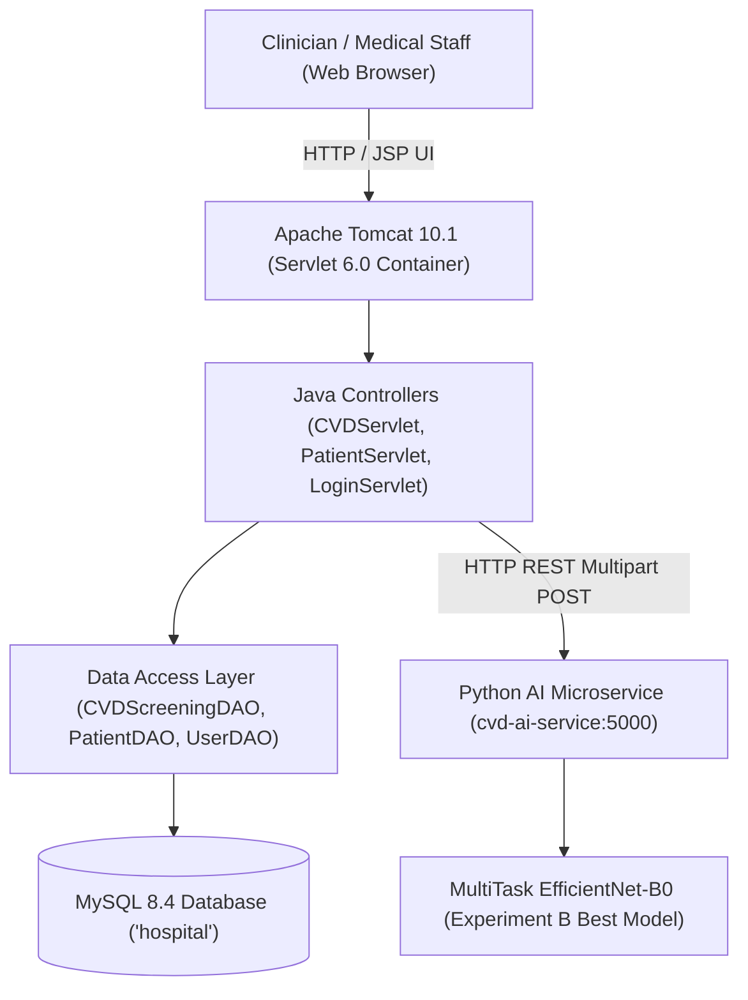

# CareConnect HMS + Retinal AI: Phase 7 Integration Plan

**Author:** Senior Java Full-Stack & Machine Learning Integration Team  
**Date:** October 18, 2026  
**Status:** Approved for Implementation  
**Project Root:** `C:\Users\vinay\javacode\HospitalManagementSystem Project`  
**Target Environment:** Java 21 LTS (Jakarta EE 10 / Tomcat 10.1), MySQL 8.4, Python 3.12 (PyTorch CPU, FastAPI)

---

## 1. Existing System Architecture



### Current Components & Stack:
1. **Frontend / Web Presentation**:
   - Server-Side JavaServer Pages (JSP 3.1 / Jakarta EE 10).
   - Responsive CSS design system in `src/main/webapp/css/style.css`.
   - Retinal screening UI: `new-screening.jsp`, `cvd-screenings.jsp`, `cvd-report.jsp`.
2. **Backend Application Layer**:
   - Jakarta Servlets (`CVDServlet`, `PatientServlet`, `DoctorServlet`, `LoginServlet`).
   - HTTP Client service: `CVDClient.java` (Java 11+ `java.net.http.HttpClient` with multipart form-data).
   - Models: `CVDScreening`, `Patient`, `Doctor`, `User`.
3. **Database Layer**:
   - MySQL 8.4 on `localhost:3306`, database `hospital`.
   - JDBC connection via `DBConnection.java` (`com.mysql.cj.jdbc.Driver`).
   - Table `cvd_screenings` storing patient ID, doctor ID, appointment ID, image path, predictions, probabilities, and clinical notes.
4. **AI Microservice (`cvd-ai-service`)**:
   - Python 3.12, PyTorch 2.14 CPU, FastAPI 0.142, Uvicorn 0.54.
   - Operates on `http://127.0.0.1:5000`.

---

## 2. Model & Checkpoint Loading Strategy

### Target Checkpoint:
- Checkpoint file: `ml/checkpoints/mbrset/experiment_b_efficientnet_b0/best_model.pt` (SHA256 verified, derived from clean mBRSET vascular_disease target training).
- Model Architecture: MultiTask EfficientNet-B0 (`CareConnectMultiTaskNet`).
- State Dictionary Keys:
  - Backbone: `features.*`, `avgpool.*`, `dropout.*` (1,280 features).
  - Heads: `head_vd.weight`, `head_vd.bias` (Vascular Disease binary logit).
  - `head_ht.weight`, `head_ht.bias` (Systemic Hypertension binary logit).
  - `head_dr.weight`, `head_dr.bias` (Diabetic Retinopathy 5-class logits).

### Preprocessing Protocol:
Must strictly match training-time validation transforms (`ml/src/dataset.py`):
```python
transforms.Compose([
    transforms.Resize((224, 224), interpolation=InterpolationMode.BILINEAR, antialias=True),
    transforms.ToTensor(),
    transforms.Normalize(mean=[0.485, 0.456, 0.406], std=[0.229, 0.224, 0.225]),
])
```

### Calibrated Decision Thresholds (Frozen from Validation Split):
- `vascular_disease`: **0.4996** (Youden's $J$ on validation partition).
- `systemic_hypertension`: **0.4288** (Youden's $J$ on validation partition).
- `dr_grade`: $\text{argmax}(\text{softmax}(\text{logits}))$, confidence = top class probability.

---

## 3. Strict Clinical Safety & Result Presentation Guidelines

Per rigorous Phase 6 audit findings:
* **Vascular Disease (Systemic Target)**:
  - Test ROC-AUC is **0.5202** (95% CI: `[0.3936, 0.6416]`), indicating near-chance discrimination for systemic vascular disease from handheld non-mydriatic fundus images alone.
  - **Clinical Rule 1**: Never state or imply that the patient definitely has or does not have cardiovascular disease.
  - **Clinical Rule 2**: Do NOT present arbitrary Low/Moderate/High risk categories without validated protocol.
  - **Clinical Rule 3**: Label the CVD output explicitly as **"Experimental Research Screening — Requires Clinical Correlation"**.
* **Diabetic Retinopathy (Ocular Target)**:
  - Direct microvascular ocular finding with **76.99%** test accuracy.
  - **Clinical Rule 4**: Never describe diabetic retinopathy accuracy as proof of cardiovascular disease detection accuracy.
* **Clinical Recommendation**:
  - Always require a comprehensive physician exam, blood pressure check, lipid panel, and standard ECG before any cardiovascular diagnosis is rendered.

---

## 4. API Contract (`cvd-ai-service`)

### Endpoint 1: `GET /health`
* **Response**:
```json
{
  "status": "healthy",
  "model_loaded": true,
  "model_version": "2.0.0-experiment_b",
  "architecture": "CareConnectMultiTaskNet (EfficientNet-B0)",
  "device": "cpu",
  "tasks": ["vascular_disease", "systemic_hypertension", "dr_grade"]
}
```

### Endpoint 2: `POST /predict`
* **Request**: `multipart/form-data` with field `file` containing image bytes (`image/jpeg`, `image/png`). Max size: 25 MB.
* **Validation**:
  - Rejects missing file (HTTP 400).
  - Rejects non-image extensions or unreadable/corrupted files (HTTP 400).
  - Rejects dimensions $< 64 \times 64$ pixels (HTTP 400).
* **Response (HTTP 200)**:
```json
{
  "status": "success",
  "model_version": "2.0.0-experiment_b",
  "cvd_prediction": "Positive",
  "cvd_probability": 0.5412,
  "cvd_threshold": 0.4996,
  "hypertension_prediction": "Positive",
  "hypertension_probability": 0.5120,
  "hypertension_threshold": 0.4288,
  "dr_grade": "No DR",
  "dr_confidence": 0.8340,
  "dr_probabilities": {
    "No DR": 0.8340,
    "Mild": 0.1020,
    "Moderate": 0.0410,
    "Severe": 0.0150,
    "Proliferative": 0.0080
  },
  "risk_level": "Experimental Screening - Requires Clinical Review",
  "recommendation": "Experimental AI research output. Complete comprehensive cardiovascular risk assessment (BP, fasting blood sugar, lipid profile, ECG) by an attending physician is required. Dilated eye exam recommended for diabetic retinopathy screening.",
  "clinical_caveats": "Retinal fundus image-only model exhibits weak discrimination on systemic vascular disease (Test ROC-AUC: 0.5202). Diabetic Retinopathy accuracy (76.99%) is an ocular finding and does not indicate CVD accuracy.",
  "experimental_flag": true
}
```

---

## 5. Security & Authorization Requirements

1. **Authentication Gate**:
   - `CVDServlet` must verify `request.getSession().getAttribute("user") != null`.
   - Unauthenticated requests must be redirected to `/login.jsp?error=unauthorized`.
2. **Role-Based Access**:
   - Users with roles `ADMIN`, `DOCTOR`, `RECEPTIONIST` can view and perform screenings.
3. **Patient Isolation & Privacy**:
   - Every screening record is tied to a verified `patient_id`.
   - Clinicians can only query and view screenings for valid patients.
4. **Input Sanitization & File Upload Safety**:
   - File extensions validated against allowlist (`.jpg`, `.jpeg`, `.png`).
   - File names sanitized to remove directory traversal characters (`..`, `/`, `\`).
   - Unique UUID prefixed to file names.
   - Max file size strictly enforced (25 MB).
5. **No Exposure of Internal Paths / Secrets**:
   - Error messages must not leak internal server paths or stack traces.

---

## 6. Implementation Sequence

1. **Step 1: Python AI Service Update (`cvd-ai-service/`)**:
   - Update `config.json` with Experiment B parameters and threshold definitions.
   - Update `inference.py` to load `CareConnectMultiTaskNet` with state-dict compatibility.
   - Update `api_server.py` with strict validation, error sanitization, and clinical disclaimer structures.
2. **Step 2: Java Client & Servlet Hardening (`CVDClient.java`, `CVDServlet.java`)**:
   - Add session authentication and role validation to `CVDServlet.java`.
   - Update `CVDClient.java` to handle the updated JSON contract.
   - Ensure clean error handling when AI service is offline.
3. **Step 3: Clinical Presentation Update (`cvd-report.jsp`, `new-screening.jsp`)**:
   - Replace misleading diagnostic banners with transparent clinical research indicators.
   - Display explicit test-set performance caveats.
4. **Step 4: End-to-End Testing**:
   - Python unit tests for model loading, corrupt images, health checks.
   - Java integration tests for client-server communication and authentication gates.
5. **Step 5: Documentation & Delivery**:
   - Produce `cvd-ai-service/README.md` and `ml/reports/PHASE7_IMPLEMENTATION_REPORT.md`.
