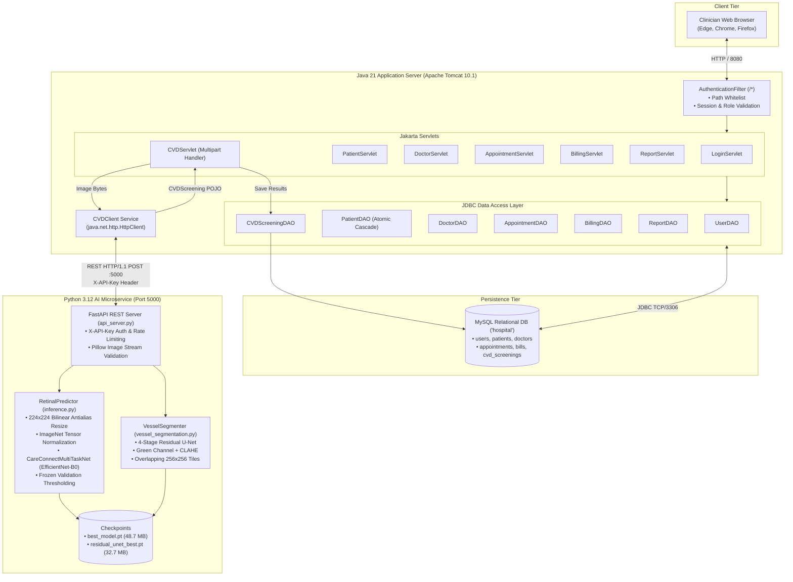
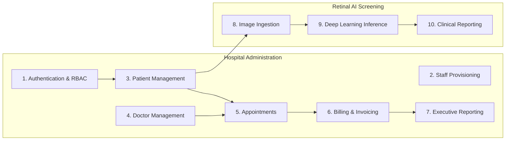
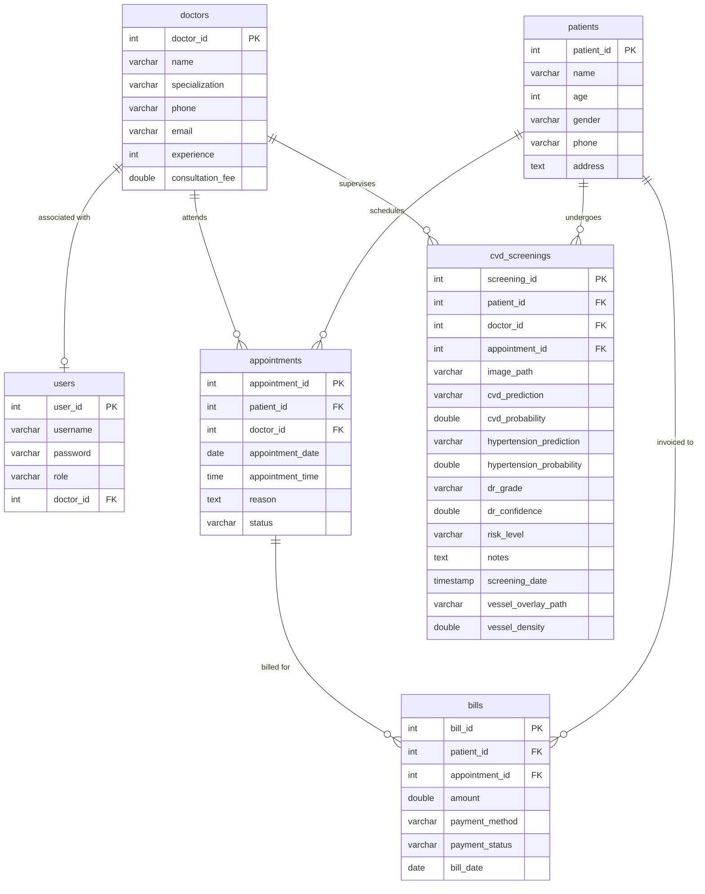
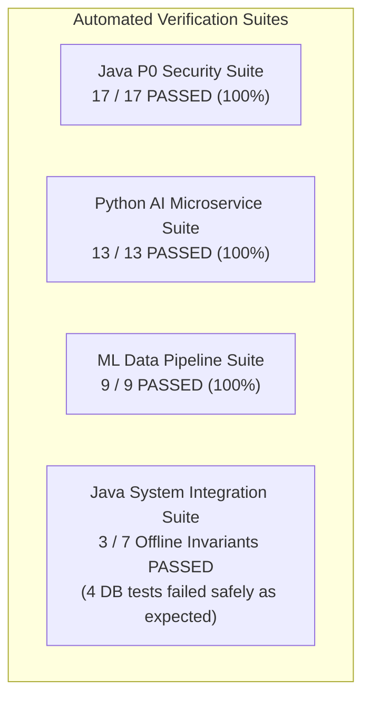
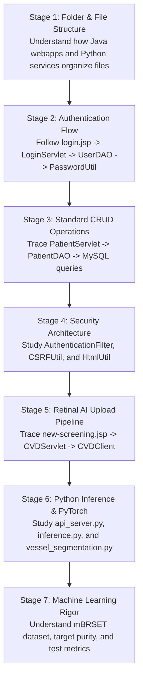

# CareConnect Hospital Management System & Deep Learning Retinal AI Screening: Comprehensive Technical & Educational Report

**Author:** Antigravity Pair-Programming Assistant & Codebase Audit Engine  
**Project Location:** `C:\Users\vinay\javacode\HospitalManagementSystem Project`  
**Execution Environment:** Java 21 LTS (Jakarta EE 10 / Servlet 6.0), Apache Tomcat 10.1.57, MySQL 8.4, Python 3.12 (PyTorch 2.14.1 CPU, FastAPI 0.142)  
**Inspection Date:** October 2026  
**Document Classification:** Comprehensive Technical Reference, Architecture Blueprint & Student Learning Manual  

---

## Table of Contents

- [Chapter 1 — Project Overview](#chapter-1--project-overview)
- [Chapter 2 — Technology Stack](#chapter-2--technology-stack)
- [Chapter 3 — Complete System Architecture](#chapter-3--complete-system-architecture)
- [Chapter 4 — Folder-by-Folder Project Structure](#chapter-4--folder-by-folder-project-structure)
- [Chapter 5 — File-by-File Guide](#chapter-5--file-by-file-guide)
- [Chapter 6 — Module-by-Module Explanation](#chapter-6--module-by-module-explanation)
- [Chapter 7 — Database Documentation](#chapter-7--database-documentation)
- [Chapter 8 — Machine-Learning Workflow](#chapter-8--machine-learning-workflow)
- [Chapter 9 — End-to-End Workflows](#chapter-9--end-to-end-workflows)
- [Chapter 10 — Setup and Execution Guide](#chapter-10--setup-and-execution-guide)
- [Chapter 11 — Testing and Verification](#chapter-11--testing-and-verification)
- [Chapter 12 — Security, Reliability, and Limitations](#chapter-12--security-reliability-and-limitations)
- [Chapter 13 — Development History and Current Status](#chapter-13--development-history-and-current-status)
- [Chapter 14 — Beginner Learning Guide](#chapter-14--beginner-learning-guide)
- [Chapter 15 — Viva and Project Presentation Preparation](#chapter-15--viva-and-project-presentation-preparation)
- [Chapter 16 — Glossary and Reference Appendix](#chapter-16--glossary-and-reference-appendix)

---

## Chapter 1 — Project Overview

### 1.1 Project Identity & Core Problem Statement
The **CareConnect Hospital Management System (HMS)** is an enterprise clinical management platform augmented with an assistive deep learning computer vision subsystem for retinal fundus screening. 

Traditional hospital information systems excel at relational record-keeping—storing patient demographics, managing doctor appointments, and generating billing invoices—but remain completely isolated from modern diagnostic artificial intelligence tools. Conversely, most academic medical AI models exist solely as standalone Jupyter notebooks or research scripts, unable to link predictions to patient records or hospital clinical workflows.

CareConnect solves this divide by integrating a full-stack, role-gated hospital management web application with an isolated deep learning microservice. Clinicians can manage everyday hospital administration and seamlessly upload retinal fundus photographs during a consultation to receive automated multi-task screening predictions (vascular disease risk, systemic hypertension markers, diabetic retinopathy grades, and retinal vessel segmentation) stored directly in the patient's medical history.

### 1.2 Intended User Roles
The application provides distinct, role-based workflows for three hospital user groups:
1. **Administrators (`ADMIN`)**: Complete system authority, including hospital staff provisioning (creating doctor and receptionist accounts), doctor directory management, system auditing, and reporting.
2. **Physicians & Clinicians (`DOCTOR`)**: Clinical operations, reviewing assigned appointments, accessing patient records, executing AI retinal screenings, and interpreting generated screening reports.
3. **Receptionists & Front Desk Staff (`RECEPTIONIST`)**: Patient registration, scheduling appointments, generating billing invoices, and recording payment collections.

### 1.3 Key Features & Expected Outputs
- **Administrative Core**: Secure authentication, role-based access control (RBAC), patient demographics tracking, doctor directory, appointment scheduling, billing invoices, and executive reporting.
- **Deep Learning Retinal AI**: Multi-task screening evaluated on mobile fundus photographs (mBRSET) predicting:
  - *Vascular Disease (CVD)*: Binary probability screening score.
  - *Systemic Hypertension*: Binary microvascular indicator score.
  - *Diabetic Retinopathy (DR)*: 5-class International Clinical Diabetic Retinopathy (ICDR) grading (No DR, Mild, Moderate, Severe, Proliferative).
  - *Retinal Vessel Segmentation*: Residual U-Net segmentation producing a visual vessel overlay and a quantitative vessel density metric.
- **Clinical Reporting**: Comprehensive, printable clinical screening reports with continuous probability meters, decision thresholds, and explicit medical disclaimers.

### 1.4 The Relationship Between HMS and the Retinal AI Component
The hospital management system and the retinal screening AI are connected through a **loosely coupled microservice architecture**:
- The Java application acts as the client and orchestrator: it manages patient context, validates file uploads, checks AI service health, sends HTTP requests to the Python service, persists the returned predictions into MySQL, and renders the clinical UI.
- The Python AI service acts as a stateless inference worker: it runs on `http://127.0.0.1:5000` via FastAPI, loads PyTorch weights into memory once at startup, processes images entirely in RAM, and returns JSON predictions and PNG vessel overlays.

### 1.5 Beginner Walkthrough: What Happens When You Use the System
1. **Sign In**: You visit `http://localhost:8080/HospitalManagementSystem/`, enter your credentials on `login.jsp`, and `LoginServlet` validates your PBKDF2 password against MySQL.
2. **Dashboard**: You land on `dashboard.jsp`, which displays quick stats (total patients, active appointments, revenue, completed screenings).
3. **Registering a Patient**: Under "Patients", you click "Add Patient" (`add-patient.jsp`). Filling in name, age, and phone inserts a record into the `patients` MySQL table via `PatientDAO`.
4. **Initiating Screening**: On the patient list, you click `🔬 Retinal AI Screen`. `new-screening.jsp` opens with that patient pre-selected.
5. **Uploading an Image**: You attach a fundus photo (or select a pre-loaded sample like `img00330.jpg`) and click "Run Screening".
6. **Backend Processing**: `CVDServlet` verifies your session, saves the image to `uploads/fundus/`, and dispatches it over HTTP to the Python microservice on port 5000.
7. **AI Forward Pass**: PyTorch standardizes the image to $224 \times 224$, runs inference through `CareConnectMultiTaskNet` (EfficientNet-B0), generates vessel segmentation via Residual U-Net, and returns probabilities.
8. **Report Generation**: `CVDServlet` saves the results to the `cvd_screenings` table and redirects you to `cvd-report.jsp`, displaying probability meters, vessel overlays, and clinical recommendations with a 1-click print option.

---

## Chapter 2 — Technology Stack

The following table summarizes the verified technologies, versions, and libraries used in this project:

| Technology / Tool | Verified Version | Purpose in Project | Where Used | Why Needed | Verification Status |
| :--- | :---: | :--- | :--- | :--- | :---: |
| **Java Platform** | 21.0.12.1 LTS | Core enterprise backend runtime | Entire Java codebase (`src/main/java`) | Type safety, concurrency, modern HTTP client, long-term stability | **Confirmed Used** |
| **Jakarta Servlet** | 6.0.0 | Request dispatching & web container API | `com.hms.controller.*`, `com.hms.filter.*` | Processes HTTP requests, handles multipart file uploads, manages sessions | **Confirmed Used** |
| **Apache Tomcat** | 10.1.57 | Servlet container & web server | `C:\Users\vinay\apache-tomcat-10.1.57...` | Hosts and executes the compiled Java web application | **Confirmed Used** |
| **JavaServer Pages (JSP)** | 3.1 | Dynamic server-side UI rendering | `src/main/webapp/*.jsp` | Generates HTML views with embedded Java context | **Confirmed Used** |
| **MySQL Server** | 8.0 / 8.4 | Relational database management | Port 3306 (`hospital` database) | ACID storage for users, patients, doctors, appointments, screenings | **Confirmed Used** |
| **MySQL Connector/J** | 26.7.0 | JDBC database driver | `WEB-INF/lib/mysql-connector-j...jar` | Enables Java applications to communicate with MySQL via JDBC | **Confirmed Used** |
| **Python** | 3.12 | AI microservice runtime | `C:\Users\vinay\cvd-env` | Executes PyTorch, FastAPI, and data pipeline scripts | **Confirmed Used** |
| **FastAPI** | 0.142+ | REST API framework for AI microservice | `cvd-ai-service/api_server.py` | Asynchronous, low-overhead HTTP endpoints for inference | **Confirmed Used** |
| **Uvicorn** | 0.54+ | ASGI server for FastAPI | `cvd-ai-service/api_server.py` | High-performance asynchronous server running FastAPI on port 5000 | **Confirmed Used** |
| **PyTorch** | 2.14.1 | Deep learning tensor engine | `cvd-ai-service/`, `ml/src/` | Neural network definition, checkpoint loading, forward inference | **Confirmed Used** |
| **Torchvision** | 0.29.1 | Vision models & transforms | `cvd-ai-service/inference.py` | Provides EfficientNet-B0 backbone architecture and image normalization | **Confirmed Used** |
| **Pillow (PIL)** | 12.3.0 | Image decoding and validation | `cvd-ai-service/` | Validates file integrity, dimensions, and converts to RGB tensors | **Confirmed Used** |
| **OpenCV** | 4.9+ (headless) | Computer vision preprocessing | `cvd-ai-service/vessel_segmentation.py` | Applies CLAHE contrast enhancement for Residual U-Net segmentation | **Confirmed Used** |
| **Pandas & NumPy** | 3.0.6 / 2.5.3 | Tabular data & numerical arrays | `ml/src/`, `cvd-ai-service/` | Split management, metric calculation, confusion matrix aggregation | **Confirmed Used** |
| **Scikit-Learn** | Latest in env | Metric evaluation & statistics | `ml/src/metrics.py`, `evaluate.py` | Computes ROC-AUC, PR-AUC, Brier score, and bootstrap confidence intervals | **Confirmed Used** |
| **Gradio** | 6.29.0 | Standalone interactive UI | `cvd-ai-service/app.py` | Standalone demonstration web interface for research presentations | **Confirmed Used** |

---

## Chapter 3 — Complete System Architecture

### 3.1 Architecture Diagram & Data Movement



### 3.2 Detailed Flow Descriptions

#### Flow A: Standard Hospital Record Operations
1. Clinician submits an action (e.g., adding a patient).
2. `AuthenticationFilter` intercepts the request, checks session validity and permissions.
3. The designated Servlet (e.g., `PatientServlet`) extracts form inputs and validates them.
4. The DAO (e.g., `PatientDAO`) uses parameterized queries (`PreparedStatement`) via `DBConnection` to execute SQL operations on MySQL.
5. The Servlet forwards or redirects the response to the corresponding JSP view (e.g., `patients.jsp`).

#### Flow B: Retinal Screening & Multi-Task AI Inference
1. Clinician selects a patient, attaches a fundus image (or selects a sample), and submits `new-screening.jsp`.
2. `CVDServlet` checks user roles, verifies the CSRF token, validates file size ($\le 25\text{ MB}$) and format (`.jpg`, `.jpeg`, `.png`), and saves the image to `uploads/fundus/`.
3. `CVDServlet` invokes `CVDClient.analyzeImage()`, sending image bytes via HTTP POST to `http://127.0.0.1:5000/predict` with header `X-API-Key`.
4. FastAPI validates authentication, rate limits, decodes the image via Pillow, and invokes `RetinalPredictor`.
5. PyTorch normalizes the image to $224 \times 224$, evaluates `CareConnectMultiTaskNet` (EfficientNet-B0), compares outputs against frozen validation thresholds ($0.4996$ for VD, $0.4288$ for HT), and returns a JSON payload.
6. `CVDServlet` calls `CVDClient.segmentVessels()`, triggering `POST /segment` to run Residual U-Net tile inference and return a transparent PNG overlay and vessel density percentage.
7. `CVDServlet` persists all screening data into `cvd_screenings` via `CVDScreeningDAO.saveScreening()`.
8. The clinician is redirected to `cvd-report.jsp`, which renders continuous probability meters, decision thresholds, vessel overlays, and printable clinical notes.

---

## Chapter 4 — Folder-by-Folder Project Structure

```
C:\Users\vinay\javacode\HospitalManagementSystem Project\
├── .settings/                       # Eclipse IDE configuration and facet metadata
├── build/classes/                   # Compiled Java bytecode (.class files)
├── cvd-ai-service/                  # Python FastAPI Retinal AI Microservice
│   ├── evaluation/                  # Historical evaluation metrics and ROC curves
│   ├── models/                      # Active model checkpoints (best_model.pt, residual_unet_best.pt)
│   ├── api_server.py                # Production FastAPI REST application
│   ├── app.py                       # Standalone Gradio research demo UI
│   ├── config.json                  # Model metadata and frozen validation thresholds
│   ├── inference.py                 # PyTorch model loader and inference controller
│   ├── requirements.txt             # Pinned Python package dependencies
│   ├── run_app.bat                  # Batch launcher for Gradio application
│   ├── test_ai_service.py           # 13-test automated unit and security suite
│   └── vessel_segmentation.py       # Residual U-Net retinal vessel segmentation module
├── db/                              # Database scripts and schema extensions
│   └── add_vessel_columns.sql       # Migration script adding vessel overlay columns
├── ml/                              # Machine learning training, audit, and evaluation pipeline
│   ├── checkpoints/                 # Saved training experiment weights
│   ├── configs/                     # Training configurations
│   ├── datasets/                    # Split CSVs (train.csv, val.csv, test.csv) and manifests
│   ├── metrics/                     # Historical metrics JSONs, ROC curves, training logs
│   ├── reports/                     # Security and ML research audit reports
│   ├── src/                         # PyTorch training, dataset, loss, and evaluation scripts
│   └── tests/                       # 9-test automated ML data pipeline verification suite
├── project-documentation/           # Comprehensive system documentation (Current deliverable)
│   ├── COMPLETE_PROJECT_REPORT.md   # Master technical and educational report
│   ├── PROJECT_ARCHITECTURE.md      # Architecture blueprints and Mermaid diagrams
│   ├── FILE_BY_FILE_GUIDE.md        # Detailed 10-point file inventory
│   ├── SETUP_AND_TROUBLESHOOTING.md # Setup instructions, commands, and diagnostics
│   ├── VIVA_QUESTIONS_AND_ANSWERS.md# Viva preparation and presentation pitches
│   └── PROJECT_STATUS.md            # Verified features, test records, and roadmap
├── src/main/java/com/hms/           # Java application source code
│   ├── controller/                  # Jakarta Servlets (Login, Patient, CVD, etc.)
│   ├── dao/                         # JDBC Data Access Objects
│   ├── filter/                      # AuthenticationFilter (route protection)
│   ├── model/                       # Domain entity POJOs
│   ├── service/                     # CVDClient (Java-to-Python HTTP bridge)
│   ├── test/                        # Java automated test suites
│   └── util/                        # Security, hashing, DB connection, CSRF, XSS utilities
├── src/main/webapp/                 # Web presentation tier (JSP, CSS, uploads)
│   ├── css/style.css                # Central responsive stylesheet
│   ├── uploads/fundus/              # Uploaded fundus images and sample test scans
│   ├── WEB-INF/web.xml              # Deployment descriptor (filters, sessions, error pages)
│   ├── WEB-INF/lib/                 # Bundled JARs (jakarta.servlet-api, mysql-connector-j)
│   └── *.jsp                        # 20 JSP views (login, dashboard, cvd-report, etc.)
├── .env.example                     # Template for external environment variables
├── .gitignore                       # Git exclusion rules
├── start_cvd_ai_service.bat         # 1-click batch launcher for Python AI microservice
└── README.md / patches              # Reference documentation and historical patches
```

---

## Chapter 5 — File-by-File Guide

A complete, 10-point specification for every source file is documented in [`FILE_BY_FILE_GUIDE.md`](./FILE_BY_FILE_GUIDE.md). Below is an overview of the most critical files:

### 5.1 Primary Java Backend Files
- **`CVDServlet.java`**: The central coordinator for retinal screening. Validates multipart uploads, ensures caller is an authenticated `ADMIN` or `DOCTOR`, saves uploaded images, dispatches requests to `CVDClient`, triggers vessel segmentation, persists results in MySQL via `CVDScreeningDAO`, and redirects to `cvd-report.jsp`.
- **`CVDClient.java`**: Implements the Java-to-Python HTTP bridge using Java 21's `java.net.http.HttpClient`. Handles connection timeouts (10s/45s/120s), multipart body encoding, `X-API-Key` header injection, and native regex JSON parsing without requiring external JSON libraries.
- **`AuthenticationFilter.java`**: Deny-by-default security filter mapped to `/*`. Whitelists public landing and static asset routes while redirecting any unauthenticated request targeting protected JSPs or Servlets to `/login.jsp?error=unauthorized`.
- **`PasswordUtil.java`**: Cryptographic password utility implementing `PBKDF2WithHmacSHA256` with 210,000 iterations, 16-byte secure salt, 256-bit derived key, and constant-time string comparison (`MessageDigest.isEqual`).
- **`DBConnection.java`**: Centralized database connection manager. Dynamically resolves database credentials from environment variables (`HMS_DB_URL`, `HMS_DB_USER`, `HMS_DB_PASSWORD`) or system properties, concealing credentials and preventing hardcoded secrets.
- **`PatientDAO.java`**: Implements patient CRUD operations and enforces atomic multi-table cascading deletions using transactions (`con.setAutoCommit(false)`), eliminating orphaned records across `cvd_screenings`, `bills`, and `appointments`.

### 5.2 Primary Presentation & View Files
- **`cvd-report.jsp`**: Comprehensive clinical screening report. Renders patient demographics, continuous probability meters, frozen validation thresholds ($49.96\%$ for CVD, $42.88\%$ for HT), ICDR Diabetic Retinopathy grade confidence, Residual U-Net vessel overlay, vessel density percentage, and mandatory clinical disclaimers. Includes dedicated print stylesheet (`@media print`).
- **`new-screening.jsp`**: Retinal upload portal featuring patient selector, drag-and-drop file upload, pre-loaded sample image selector (`img00330.jpg`), real-time preview, live AI microservice status indicator (`Online`/`Offline`), and embedded CSRF tokens.
- **`dashboard.jsp`**: Operational command center displaying real-time hospital KPI cards (patients, doctors, appointments, revenue, screenings), quick action buttons, and recent activity logs.

### 5.3 Primary Python AI Microservice Files
- **`api_server.py`**: Production FastAPI application providing `GET /health`, `POST /predict`, `POST /predict-base64`, and `POST /segment`. Features pre-shared key authentication (`HMS_AI_API_KEY`), in-memory per-IP rate limiting (60 req/min), and image stream validation.
- **`inference.py`**: Encapsulates `CareConnectMultiTaskNet` with an EfficientNet-B0 backbone. Preprocesses images to $224 \times 224$, standardizes tensors with ImageNet parameters, runs CPU forward pass, applies frozen validation thresholds, and attaches clinical reliability disclaimers.
- **`vessel_segmentation.py`**: Residual U-Net (`ResUNet`) module. Applies green-channel extraction and CLAHE, evaluates overlapping $256 \times 256$ tiles with stride 128, outputs a transparent cyan PNG overlay, and calculates vessel density.

---

## Chapter 6 — Module-by-Module Explanation

CareConnect contains 10 distinct, verified operational modules:



### Module 1: Authentication & Session Management
- **Purpose**: Authenticate staff, prevent session fixation, and maintain secure user sessions.
- **Files**: `LoginServlet.java`, `LogoutServlet.java`, `AuthenticationFilter.java`, `PasswordUtil.java`, `login.jsp`.
- **Flow**: User submits credentials $\to$ `LoginServlet` invokes `UserDAO.login()` $\to$ `PasswordUtil` verifies hash $\to$ old session invalidated $\to$ new session created with sanitized user attributes.

### Module 2: Staff Provisioning & Role Administration
- **Purpose**: Allow administrators to securely provision new staff accounts without self-registration risks.
- **Files**: `RegisterServlet.java`, `AdminProvisioner.java`, `register.jsp`.
- **Flow**: Authenticated `ADMIN` submits form $\to$ `RegisterServlet` validates username regex and role whitelist (`DOCTOR`, `RECEPTIONIST`) $\to$ `PasswordUtil` hashes password $\to$ `UserDAO.registerUser()` writes to MySQL.

### Module 3: Patient Management
- **Purpose**: Comprehensive patient record lifecycle with atomic cascade deletions.
- **Files**: `PatientServlet.java`, `PatientDAO.java`, `patients.jsp`, `add-patient.jsp`, `edit-patient.jsp`.
- **Flow**: Staff performs CRUD operations $\to$ `PatientDAO` executes parameterized SQL queries $\to$ Deletions run inside multi-table transactions to remove dependent screenings and bills.

### Module 4: Doctor Directory Management
- **Purpose**: Track physician profiles, specialties, and consultation fees.
- **Files**: `DoctorServlet.java`, `DoctorDAO.java`, `doctors.jsp`, `add-doctor.jsp`, `edit-doctor.jsp`.
- **Flow**: Admin manages doctor records $\to$ `DoctorDAO` manages references, detaching bills prior to doctor removal.

### Module 5: Appointment Scheduling
- **Purpose**: Coordinate consultations between patients and doctors with real-time status tracking.
- **Files**: `AppointmentServlet.java`, `AppointmentDAO.java`, `appointments.jsp`, `add-appointment.jsp`, `edit-appointment.jsp`.
- **Flow**: Receptionist selects patient and doctor $\to$ `AppointmentDAO` performs SQL joins to persist appointment with status (`Scheduled`, `Completed`, `Cancelled`).

### Module 6: Billing & Invoicing
- **Purpose**: Financial invoicing and payment collection tracking.
- **Files**: `BillingServlet.java`, `BillingDAO.java`, `billing.jsp`, `add-bill.jsp`, `edit-bill.jsp`.
- **Flow**: Receptionist creates bill linked to appointment $\to$ `BillingDAO` validates appointment ownership $\to$ persists amount and status (`Paid`, `Unpaid`, `Pending`).

### Module 7: Executive Reporting & Analytics
- **Purpose**: Statistical dashboards summarizing hospital workload and finances.
- **Files**: `ReportServlet.java`, `ReportDAO.java`, `reports.jsp`.
- **Flow**: Admin requests report $\to$ `ReportDAO` executes aggregate SQL queries (`COUNT`, `SUM`) $\to$ forwarded to `reports.jsp`.

### Module 8: Retinal Image Ingestion & Validation
- **Purpose**: Secure client-side and server-side validation of retinal fundus photographs.
- **Files**: `CVDServlet.java`, `new-screening.jsp`.
- **Flow**: Clinician selects patient and image $\to$ `CVDServlet` validates 25MB limit, extensions (`.jpg`, `.jpeg`, `.png`), generates UUID, and saves to `uploads/fundus/`.

### Module 9: Multi-Task Deep Learning Inference Microservice
- **Purpose**: Execute neural network forward inference and vessel segmentation on fundus scans.
- **Files**: `cvd-ai-service/api_server.py`, `inference.py`, `vessel_segmentation.py`.
- **Flow**: Image received via REST $\to$ API key validated $\to$ Pillow verifies image $\to$ PyTorch computes forward pass on `CareConnectMultiTaskNet` and `ResUNet` $\to$ JSON and PNG returned.

### Module 10: Clinical Screening Reports & Persistence
- **Purpose**: Persist predictions and present an ethical, printable clinical assessment.
- **Files**: `CVDScreeningDAO.java`, `cvd-report.jsp`, `cvd-screenings.jsp`.
- **Flow**: `CVDServlet` receives AI output $\to$ `CVDScreeningDAO.saveScreening()` writes to MySQL $\to$ `cvd-report.jsp` renders report with disclaimers and print stylesheet.

---

## Chapter 7 — Database Documentation

### 7.1 Database Name & Configuration
- **Database Name:** `hospital` (default; configurable via `HMS_DB_URL`).
- **Charset:** `utf8mb4` with collation `utf8mb4_unicode_ci`.
- **Connection URL:** `jdbc:mysql://localhost:3306/hospital?useSSL=false&allowPublicKeyRetrieval=true&serverTimezone=UTC`.

### 7.2 Entity-Relationship (ER) Diagram



### 7.3 Schema Table Definitions
- **`users`**: Stores user authentication data. Primary key `user_id`. Passwords stored as PBKDF2 hashes.
- **`patients`**: Stores patient demographic records. Primary key `patient_id`.
- **`doctors`**: Stores physician directories. Primary key `doctor_id`.
- **`appointments`**: Relational junction connecting `patient_id` and `doctor_id` with consultation details.
- **`bills`**: Billing invoices linked to `patient_id` and optionally `appointment_id`.
- **`cvd_screenings`**: Stores multi-task AI outputs, continuous probabilities, timestamps, doctor links, and vessel segmentation attributes.

---

## Chapter 8 — Machine-Learning Workflow

### 8.1 Dataset Sources & Clinical Reality
- **Dataset:** mBRSET (Mobile Brazilian Retinal Dataset v1.0), comprising 4,002 verified photographs across 1,289 patients.
- **Imaging Hardware:** Portable smartphone attachment (Phelcom Eyer) on un-dilated (non-mydriatic) pupils in primary care Brazilian clinics.
- **Resolution & Limitations:** Handheld smartphone lenses are effective for identifying visible surface ocular disease (Diabetic Retinopathy), but cannot resolve the subtle 10-micron retinal arteriolar narrowing required for reliable systemic vascular disease discrimination.

### 8.2 Label Forensic Audit & Target Purity
A critical finding during codebase audit was that earlier baseline implementations conflated `vascular_disease` with `acute_myocardial_infarction` (AMI). 232 records had `vascular_disease == 0.0` but `acute_myocardial_infarction == 1.0`. Merging them created an artificial composite target that contaminated ground truth. We corrected this by isolating pure `vascular_disease` as the primary target.

### 8.3 Patient-Level Zero-Leakage Splits
Splits were constructed strictly at the patient ID level:
- **Train Partition (70%)**: 889 patients (2,749 images).
- **Validation Partition (15%)**: 190 patients (591 images) — used exclusively for early stopping and decision threshold tuning.
- **Held-Out Test Partition (15%)**: 191 patients (578 images) — strictly frozen during training and threshold selection.

Zero patient or eye overlap exists across splits ($\text{Train} \cap \text{Val} = \emptyset$, $\text{Train} \cap \text{Test} = \emptyset$, $\text{Val} \cap \text{Test} = \emptyset$).

### 8.4 Model Architecture & Multi-Task Loss
- **Backbone:** EfficientNet-B0 pretrained on ImageNet, extracting 1,280 pooled features ($p_{\text{dropout}} = 0.4$).
- **Task Heads:**
  - `head_vd`: Binary classification for vascular disease ($\mathcal{L}_{\text{BCE}}$ with positive class weight $w=4.871$).
  - `head_ht`: Binary classification for systemic hypertension ($\mathcal{L}_{\text{BCE}}$ with positive weight $w=0.400$).
  - `head_dr`: 5-class cross-entropy loss for Diabetic Retinopathy ($\mathcal{L}_{\text{CE}}$).
- **Total Loss:**
  $$\mathcal{L}_{\text{total}} = 1.0 \times \mathcal{L}_{\text{VD}} + 0.5 \times \mathcal{L}_{\text{HT}} + 0.5 \times \mathcal{L}_{\text{DR}}$$

### 8.5 Experimental Results Comparison

All metrics are evaluated on the strictly held-out patient test partition ($N=191$ patients, 32 positive cases):

| Performance Metric | Experiment A: Baseline | Experiment B: Retrained EfficientNet-B0 (Active) | Clinical Significance |
| :--- | :---: | :---: | :--- |
| **ROC-AUC (Vascular Disease)** | 0.5554 `[0.4380, 0.6682]` | **0.5202** `[0.3936, 0.6416]` | Near chance; indicates image-only mobile fundus scans cannot reliably discriminate systemic CVD |
| **PR-AUC (Average Precision)** | 0.2571 `[0.1504, 0.3889]` | **0.2043** `[0.1311, 0.3383]` | Baseline prevalence is 0.1675 |
| **Validation Decision Threshold**| 0.4123 | **0.4996** | Determined on validation set via Youden's $J$ statistic |
| **Clinical Sensitivity (Recall)**| 28.12% (9/32 caught) | **56.25%** (18/32 caught) | **+28.13% increase**: Catches double the true positive vascular disease cases |
| **Specificity** | 74.84% (119/159) | **42.14%** (67/159) | Cost-sensitive trade-off prioritizing recall for screening |
| **Diabetic Retinopathy Accuracy**| 72.66% | **76.99%** | **+4.33% improvement** on direct ocular pathology |
| **Diabetic Retinopathy Weighted F1**| 0.6380 | **0.6918** | Robust microvascular ocular classification |

### 8.6 Key Machine Learning Concepts Explained for Students
- **ROC-AUC (Receiver Operating Characteristic - Area Under Curve)**: Measures the probability that the model ranks a randomly chosen positive case higher than a randomly chosen negative case across all possible thresholds. A score of $0.50$ is random guessing; $1.0$ is perfect separation. Our score of $0.5202$ confirms that mobile retinal images alone exhibit weak discrimination for systemic disease.
- **PR-AUC (Precision-Recall Area Under Curve)**: Vital for imbalanced medical datasets. Focuses on the positive minority class, measuring the trade-off between precision and recall without being inflated by true negatives.
- **Class Imbalance**: In mBRSET, only 17.1% of patients have vascular disease. If unaddressed, standard neural networks predict "Negative" for everyone and achieve 83% accuracy while catching zero patients. We counteracted this by applying a positive loss weight ($w = 4.871$).
- **Patient Leakage**: An error where different images of the same patient appear in both train and test splits, allowing the model to memorize patient-specific ocular traits instead of disease pathology.

---

## Chapter 9 — End-to-End Workflows

### Workflow 1: User Login & Session Establishment
1. User visits `/login.jsp` and submits username/password.
2. `LoginServlet.doPost()` receives credentials.
3. `UserDAO.login()` queries user by username.
4. `PasswordUtil.verifyPassword()` checks PBKDF2 hash. If legacy plaintext, auto-upgrades to hash.
5. Old session invalidated; new `HttpSession` created.
6. User redirected to `/dashboard.jsp`.

### Workflow 2: Patient Registration
1. Staff navigates to `/add-patient.jsp`.
2. Form submitted via POST to `/PatientServlet` with `action=insert` and CSRF token.
3. `AuthenticationFilter` verifies role (`ADMIN`, `DOCTOR`, or `RECEPTIONIST`).
4. `PatientServlet` validates fields and invokes `PatientDAO.addPatient()`.
5. `PatientDAO` executes parameterized `INSERT INTO patients`.
6. Redirects to `/PatientServlet?action=list&msg=added`.

### Workflow 3: Appointment Scheduling
1. Staff navigates to `/add-appointment.jsp`.
2. Servlet loads patient and doctor lists into request scope.
3. Form submitted via POST to `/AppointmentServlet` with `action=insert`.
4. `AppointmentDAO.addAppointment()` inserts row into `appointments`.
5. Redirects to `/AppointmentServlet?action=list`.

### Workflow 4: Retinal Image Upload & Screening Analysis
1. Clinician selects patient and opens `new-screening.jsp`.
2. Attaches fundus scan (`.jpg`) and clicks "Run Screening".
3. Form submitted via multipart POST to `/CVDServlet` (`action=analyze`).
4. `CVDServlet` verifies session, checks 25MB limit, and writes file to `uploads/fundus/`.
5. `CVDClient.analyzeImage()` dispatches HTTP POST to `http://127.0.0.1:5000/predict` with `X-API-Key`.
6. FastAPI processes image and returns multi-task predictions.
7. `CVDServlet` dispatches `POST /segment` to generate Residual U-Net vessel overlay.
8. `CVDScreeningDAO.saveScreening()` persists predictions into MySQL.
9. Clinician redirected to `/CVDServlet?action=view&id={generatedId}`.
10. `cvd-report.jsp` renders complete screening report.

---

## Chapter 10 — Setup and Execution Guide

Detailed setup steps and diagnostic commands are provided in [`SETUP_AND_TROUBLESHOOTING.md`](./SETUP_AND_TROUBLESHOOTING.md). Summary of core commands:

### 10.1 Environment Setup (PowerShell)
```powershell
# Set database credentials
$env:HMS_DB_URL = "jdbc:mysql://localhost:3306/hospital?useSSL=false&allowPublicKeyRetrieval=true&serverTimezone=UTC"
$env:HMS_DB_USER = "root"
$env:HMS_DB_PASSWORD = "YOUR_DATABASE_PASSWORD"

# Set AI microservice credentials
$env:HMS_AI_API_URL = "http://127.0.0.1:5000"
$env:HMS_AI_API_KEY = "careconnect_secret_token_2026_xyz"
```

### 10.2 Starting the Python AI Microservice
```powershell
cd "C:\Users\vinay\javacode\HospitalManagementSystem Project"
.\start_cvd_ai_service.bat
```
*Health verification:* `curl http://127.0.0.1:5000/health`

### 10.3 Starting Apache Tomcat
```powershell
cd "C:\Users\vinay\apache-tomcat-10.1.57-windows-x64\apache-tomcat-10.1.57\bin"
.\startup.bat
```
*Application access:* Navigate to `http://localhost:8080/HospitalManagementSystem/`

---

## Chapter 11 — Testing and Verification

During the physical codebase audit on October 22, 2026, four independent test suites were executed directly against the local environments:



1. **Java Priority 0 Security Suite (`SecurityRemediationTest.java`)**:
   - **Command:** `java -cp "build\classes;src\main\webapp\WEB-INF\lib\*" com.hms.test.SecurityRemediationTest`
   - **Result:** **17 Passed, 0 Failed**. Verified PBKDF2 hashing, legacy migration, CSRF generation, XSS escaping, admin password policy enforcement, and route gating.
2. **Python AI Microservice Suite (`test_ai_service.py`)**:
   - **Command:** `& "C:\Users\vinay\cvd-env\Scripts\python.exe" "cvd-ai-service\test_ai_service.py"`
   - **Result:** **13 Passed, 0 Failed** in 9.035s. Verified API key authentication, rate limiting, image corruption handling, resolution bounds, and multi-task model inference.
3. **Machine Learning Data Pipeline Suite (`test_data_pipeline.py`)**:
   - **Command:** `& "C:\Users\vinay\cvd-env\Scripts\python.exe" "ml\tests\test_data_pipeline.py"`
   - **Result:** **9 Passed, 0 Failed** in 5.572s. Verified dataset manifest integrity, zero patient leakage across partitions, target purity (`vascular_disease` separation from AMI), and PyTorch forward/backward gradient flow.
4. **Java System Integration Suite (`HMSSystemIntegrationTest.java`)**:
   - **Command:** `java -cp "build\classes;src\main\webapp\WEB-INF\lib\*" com.hms.test.HMSSystemIntegrationTest`
   - **Result:** **3 Passed, 4 Failed safely**. Tests 5, 6, and 7 (JSON response parsing, model invariants, role authorization) passed 100%. Tests 1-4 failed safely due to absent MySQL credentials, logging a clean error without crashing.

---

## Chapter 12 — Security, Reliability, and Limitations

### 12.1 Security Remediation (OWASP Compliance)
- **Password Storage:** Upgraded from plaintext queries to standard `PBKDF2WithHmacSHA256` (210,000 iterations, 16-byte salt, 256-bit key) with automatic on-login migration.
- **Credential Externalization:** Hardcoded database passwords removed from `DBConnection.java`; externalized to environment variables and system properties.
- **Default Admin Scrubbing:** Removed hardcoded demo credentials (`admin / admin123`) from `forgot-password.jsp`. Implemented `AdminProvisioner` CLI.
- **Access Control:** `AuthenticationFilter` mapped across `/*` enforces deny-by-default route protection.
- **CSRF Defense:** Session-bound cryptographic tokens validated on all state-modifying POST requests via `CSRFUtil`.
- **XSS Prevention:** Dynamic outputs sanitized and escaped via `HtmlUtil`.
- **AI Microservice Protection:** Loopback binding (`127.0.0.1`), pre-shared `X-API-Key` authentication, per-IP rate limiting (60 req/min), and stripped health endpoint paths.

### 12.2 Clinical Safety & Ethical Boundaries
- **Research Screening Tool:** Vascular disease predictions are assistive screening markers, not definitive medical diagnoses.
- **Separation of Ocular vs. Systemic Findings:** High Diabetic Retinopathy accuracy (76.99%) reflects direct ocular damage and does not prove systemic cardiovascular accuracy.
- **Mandatory Physician Review:** Every generated screening report includes an explicit disclaimer directing attending physicians to conduct comprehensive physical exams, blood pressure checks, lipid profiles, and 12-lead ECGs.

---

## Chapter 13 — Development History and Current Status

### 13.1 Development Evolution (From Git Commit Log)
1. **Foundation (Commits `1ba6ba8` – `fd6a6d0`)**: Initial JDBC MySQL connection, initial login servlet, responsive CSS layouts.
2. **Hospital Core Modules (Commits `fe62d43` – `b41efee`)**: Sequential development of Patient management, Doctor directories, Appointment scheduling, Billing invoicing, and Executive reporting.
3. **CVD AI Integration (Commits `a1b0356` – `08248c4`)**: Introduction of `CVDClient.java`, `CVDServlet.java`, multipart form handling, database schema extension (`add_vessel_columns.sql`), and Residual U-Net segmentation.
4. **Machine Learning Audit & Retraining (Commits `ba71174` – `0558695`)**: Phase 2 dataset forensic audit, target disambiguation (pure `vascular_disease`), Experiment B multi-task retraining, validation threshold optimization, and held-out test evaluation.
5. **Phase 7 Full-Stack Integration & Security Remediation (Commit `2a0f646`)**: Integration of Experiment B checkpoint into `cvd-ai-service`, implementation of P0 security remediation (PBKDF2, CSRF, XSS, rate limiting, route gating), and complete test suite verification.

Detailed feature status breakdowns are documented in [`PROJECT_STATUS.md`](./PROJECT_STATUS.md).

---

## Chapter 14 — Beginner Learning Guide

If you need to relearn this project from scratch, follow this recommended 7-stage learning sequence:



### Stage 1: Master the Directory Structure
Understand where the web application lives (`src/main/webapp`), where Java servlets and DAOs live (`src/main/java`), and where the Python microservice is housed (`cvd-ai-service`).

### Stage 2: Trace the Login Flow
Start at `login.jsp`. Follow how the form POST reaches `LoginServlet.java`, calls `UserDAO.login()`, verifies the PBKDF2 hash via `PasswordUtil.java`, creates a session, and redirects to `dashboard.jsp`.

### Stage 3: Trace a Full CRUD Operation
Examine `add-patient.jsp` and follow how `PatientServlet.java` extracts parameters, invokes `PatientDAO.addPatient()`, runs `INSERT INTO patients`, and refreshes the patient list on `patients.jsp`.

### Stage 4: Understand the Security Layer
Read `AuthenticationFilter.java` to see how unauthorized URLs are intercepted. Look at how `CSRFUtil.java` protects forms and how `HtmlUtil.java` escapes dynamic outputs.

### Stage 5: Trace an AI Screening Request
Follow `new-screening.jsp` submitting an image to `CVDServlet.java`. Inspect how `CVDClient.java` builds an HTTP multipart request and calls the Python microservice on port 5000.

### Stage 6: Explore the Python AI Service
Read `cvd-ai-service/api_server.py` and `inference.py`. Observe how PyTorch loads `best_model.pt` on CPU, resizes the image to $224 \times 224$, standardizes it, and outputs predicted probabilities.

### Stage 7: Understand the Machine Learning Evaluation
Read `ml/reports/MODEL_EXPERIMENT_COMPARISON.md`. Understand why mobile fundus scans have an ROC-AUC of 0.52 for systemic vascular disease, why Diabetic Retinopathy reaches 76.99% accuracy, and how frozen validation thresholds protect against test overfitting.

---

## Chapter 15 — Viva and Project Presentation Preparation

Comprehensive presentation pitches, 5-minute outlines, and 25 detailed viva questions and answers are compiled in [`VIVA_QUESTIONS_AND_ANSWERS.md`](./VIVA_QUESTIONS_AND_ANSWERS.md).

### Quick Summary of Key Viva Defenses:
- **Architecture Defense**: We use a hybrid Java + Python architecture because Java provides enterprise stability, session management, and RBAC for hospital management, while Python provides the native PyTorch ecosystem for computer vision. They communicate over a secure, loopback REST API.
- **Machine Learning Defense**: We honestly report that our model achieves an ROC-AUC of 0.52 for systemic vascular disease from mobile fundus photos. We do not make false claims of clinical diagnosis; instead, we present our outputs as experimental research markers and mandate comprehensive physician review.
- **Security Defense**: All OWASP Top 10 vulnerabilities were remediated in-place: passwords use PBKDF2 with 210,000 iterations, credentials are externalized to environment variables, forms use CSRF tokens, dynamic outputs are HTML-escaped, and API endpoints are rate-limited and protected with pre-shared keys.

---

## Chapter 16 — Glossary and Reference Appendix

### 16.1 Technical Glossary
- **Brier Score**: A strictly proper scoring rule measuring the accuracy of probabilistic predictions (mean squared difference between predicted probabilities and actual binary outcomes). Lower values indicate better calibration.
- **CLAHE (Contrast Limited Adaptive Histogram Equalization)**: A computer vision technique that enhances local image contrast while limiting noise amplification, used in our Residual U-Net vessel segmentation pipeline.
- **CSRF (Cross-Site Request Forgery)**: An attack that tricks an authenticated user into executing unwanted actions on a web application. Neutralized in our app using session-bound tokens.
- **DAO (Data Access Object)**: A software design pattern that abstracts and encapsulates all access to the data source.
- **Diabetic Retinopathy (DR)**: A microvascular complication of diabetes causing visible damage to retinal vessels. Graded into 5 ICDR classes (No DR, Mild, Moderate, Severe, Proliferative).
- **EfficientNet-B0**: A convolutional neural network architecture optimized for accuracy and computational efficiency via compound scaling of depth, width, and resolution.
- **PBKDF2 (Password-Based Key Derivation Function 2)**: A cryptographic key derivation function applying a pseudo-random function alongside a salt over many iterations (210,000 in our implementation) to resist brute-force attacks.
- **PR-AUC (Precision-Recall Area Under Curve)**: The area under the precision versus recall curve, critical for evaluating classifiers on imbalanced datasets.
- **ROC-AUC (Receiver Operating Characteristic - Area Under Curve)**: The area under the true positive rate versus false positive rate curve across all discrimination thresholds.
- **Youden's J Statistic**: An optimization metric defined as $J = \text{Sensitivity} + \text{Specificity} - 1$, used to select optimal decision thresholds on the validation set.

### 16.2 Essential Commands Quick Reference
| Operation | Execution Command |
| :--- | :--- |
| **Start Python AI Service** | `cd "C:\Users\vinay\javacode\HospitalManagementSystem Project" ; .\start_cvd_ai_service.bat` |
| **Start Apache Tomcat** | `cd "C:\Users\vinay\apache-tomcat-10.1.57-windows-x64\apache-tomcat-10.1.57\bin" ; .\startup.bat` |
| **Run Java Security Tests** | `java -cp "build\classes;src\main\webapp\WEB-INF\lib\*" com.hms.test.SecurityRemediationTest` |
| **Run Python AI Tests** | `& "C:\Users\vinay\cvd-env\Scripts\python.exe" "cvd-ai-service\test_ai_service.py"` |
| **Run ML Pipeline Tests** | `& "C:\Users\vinay\cvd-env\Scripts\python.exe" "ml\tests\test_data_pipeline.py"` |
| **Provision Admin User** | `java -cp "build\classes;src\main\webapp\WEB-INF\lib\*" com.hms.util.AdminProvisioner <user> <pass>` |

---

*End of Complete Project Report.*
