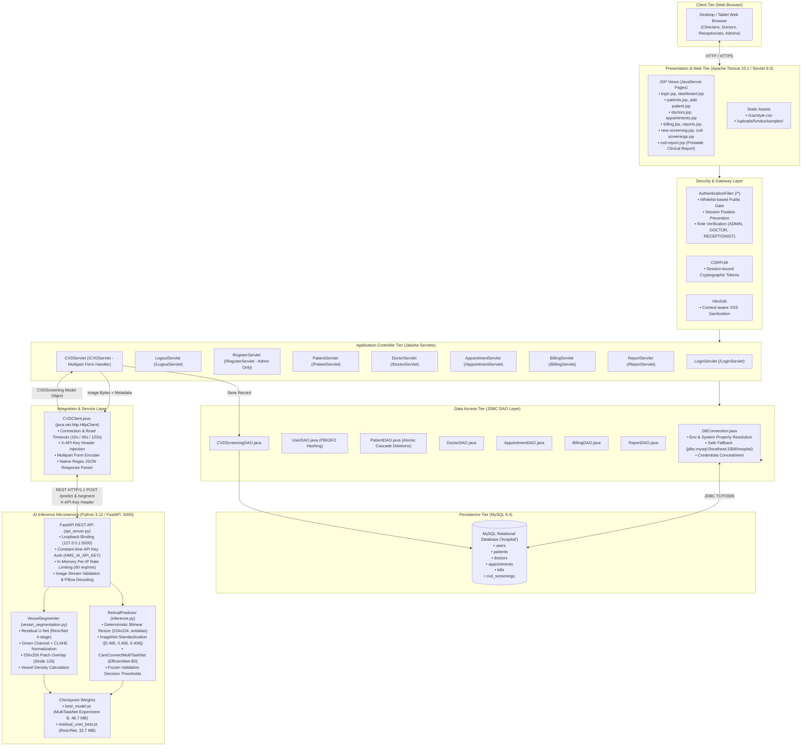
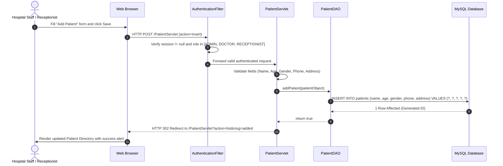
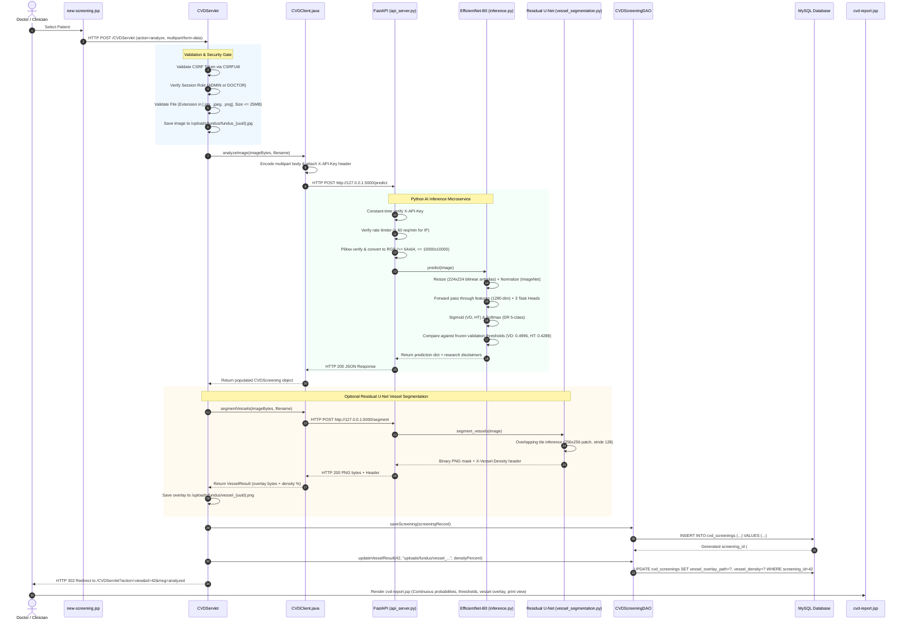

# CareConnect HMS & Retinal AI: System Architecture Documentation

**Document:** System Architecture Specification  
**System Name:** CareConnect Hospital Management System with Deep Learning Retinal Screening  
**Version:** 2.0.0-integrated  
**Date:** October 2026  
**Security Classification:** Standard Academic & Clinical Research  

---

## 1. High-Level System Overview

The **CareConnect Hospital Management System (HMS)** is a hybrid, multi-tier enterprise healthcare platform that merges traditional hospital clinical administration with deep learning computer vision. 

The architecture is deliberately divided into two loosely coupled subsystems:
1. **The Core Hospital Administration Subsystem (Java/Jakarta EE Web Application)**: Manages patient demographics, doctor directories, appointment scheduling, billing invoices, role-based access control (RBAC), and persistent screening reports.
2. **The Retinal AI Screening Subsystem (Python FastAPI & PyTorch Microservice)**: An isolated inference microservice that receives retinal fundus photographs, executes computer vision transforms, evaluates a multi-task deep neural network (`CareConnectMultiTaskNet` with an `EfficientNet-B0` backbone), runs optional Residual U-Net retinal vessel segmentation, and returns structured probability predictions with clinical disclaimers.

The two subsystems communicate strictly across a localhost loopback boundary via an authenticated HTTP/1.1 REST API, eliminating monolithic coupling and ensuring that machine learning execution cannot destabilize core hospital record-keeping.

---

## 2. Global Architecture Diagram

---

## 3. Detailed Component Interaction Flows

### 3.1 Core Hospital Management Workflow (CRUD & Database)

---

### 3.2 Retinal Screening & AI Inference End-to-End Workflow

---

## 4. Subsystem Breakdown and Boundaries

### 4.1 Java Application Layer
- **Runtime Environment:** Java 21 LTS (tested with build `21.0.12.1+1-LTS-4`).
- **Servlet Specification:** Jakarta Servlet 6.0 (`jakarta.servlet-api-6.0.0.jar`).
- **Application Server:** Apache Tomcat 10.1 (`apache-tomcat-10.1.57`).
- **Database Driver:** MySQL Connector/J 26.7.0 (`com.mysql.cj.jdbc.Driver`).
- **Package Architecture:**
  - `com.hms.controller`: HTTP request routing, session validation, form extraction, view forwarding.
  - `com.hms.filter`: Global URL pattern filtering (`/*`) ensuring no unauthenticated visitor accesses internal JSPs or servlets.
  - `com.hms.model`: Plain Old Java Objects (POJOs) representing domain entities (`User`, `Patient`, `Doctor`, `Appointment`, `Bill`, `CVDScreening`).
  - `com.hms.dao`: Direct JDBC Data Access Objects with `PreparedStatement` parameterized queries.
  - `com.hms.service`: Inter-process communication client (`CVDClient`) managing HTTP REST interactions with the Python microservice.
  - `com.hms.util`: Cross-cutting utilities for cryptography (`PasswordUtil`), database lifecycle (`DBConnection`), CSRF protection (`CSRFUtil`), XSS output sanitization (`HtmlUtil`), and administrator bootstrapping (`AdminProvisioner`).
  - `com.hms.test`: Automated regression and security verification suites (`SecurityRemediationTest`, `HMSSystemIntegrationTest`, `EndToEndServiceTest`).

### 4.2 Python AI Microservice Layer
- **Runtime Environment:** Python 3.12 within isolated virtual environment `C:\Users\vinay\cvd-env`.
- **Framework:** FastAPI 0.142+ powered by Uvicorn ASGI server.
- **Deep Learning Framework:** PyTorch 2.14.1 (CPU execution) with Torchvision 0.29.1.
- **Image Processing:** Pillow 12.3.0 and OpenCV (`opencv-python-headless` >= 4.9).
- **Service Security:**
  - Bound exclusively to localhost loopback `127.0.0.1:5000` (refuses remote network traffic).
  - Pre-shared secret header authentication via `X-API-Key` using constant-time digest comparison (`hmac.compare_digest`).
  - Per-IP rolling rate limiter enforcing 60 requests per minute to prevent resource starvation.
  - Sanitized health endpoint that conceals physical filesystem paths from callers.
- **Model Checkpoints:**
  - `best_model.pt` (48.7 MB): Verified Experiment B weights (`CareConnectMultiTaskNet`).
  - `residual_unet_best.pt` (32.7 MB): Verified weights for Residual U-Net retinal vessel segmentation.

### 4.3 Database Layer (MySQL 8.4)
- **Database Name:** `hospital` (configurable via `HMS_DB_URL`).
- **Tables:** `users`, `patients`, `doctors`, `appointments`, `bills`, `cvd_screenings`.
- **Integrity Constraints:** Foreign key references enforcing patient and doctor associations; atomic multi-table transaction blocks in `PatientDAO` ensuring zero orphaned screening records.

---

## 5. Network & Security Perimeter

| Perimeter Zone | Component | Protocol / Port | Access Rule | Authentication / Protection |
| :--- | :--- | :--- | :--- | :--- |
| **Public / LAN Client** | Web Browser | HTTP / 8080 | Allowed | Session Cookie (`HttpOnly`), `AuthenticationFilter` gate |
| **Web Container** | Tomcat 10.1 | TCP / 8080 | Inbound from Client | Role-Based Access Control (`ADMIN`, `DOCTOR`, `RECEPTIONIST`) |
| **Database Server** | MySQL 8.4 | TCP / 3306 | Localhost Only | Parametric JDBC connection (`PreparedStatement`), external credentials |
| **AI Microservice** | FastAPI / Uvicorn | TCP / 5000 | `127.0.0.1` Only | `X-API-Key` pre-shared secret, per-IP rate limit, CORS origin whitelist |

---

*End of Architecture Documentation.*
